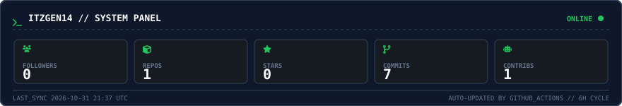
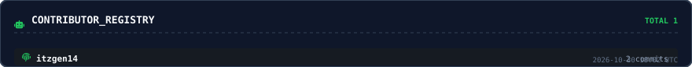

<div align="center">


<a href="https://github.com/itzgen14"></a>

<br/>


</div>

---

## `whoami`

```
itzgen14@github ~ % cat profile.txt
role        : developer / security research
focus       : web exploitation, automation, tooling
stack       : python · javascript · node · docker · git
status      : online — accepting collaboration
```

<br/>

## SYSTEM PANEL — live from GitHub API

<p align="center">
  
</p>

<p align="center">
  
</p>

<sub>Rendered by <code>scripts/update_readme_assets.py</code> — GitHub Actions runs it every 6 hours, commits the SVG back to <code>main</code>. Zero external services, zero fake numbers.</sub>

<br/>

## CONTRIBUTION ACTIVITY

<p align="center">
  
</p>

<br/>

## TECH STACK

<p align="center">
  
  
  
  
  
  
  
  
</p>

<br/>

## REPOSITORIES

<p align="center">
  
  
</p>

<br/>

## CONNECT

<p align="center">
  <a href="https://github.com/itzgen14"></a>
</p>


</div>
